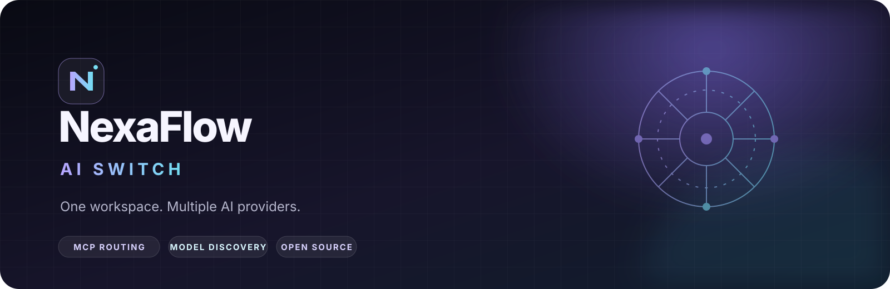

<!-- Русская главная страница NexaFlow AI Switch -->
<p align="center">
  
</p>

<p align="center">
  <a href="README.md">English</a> ·
  <a href="INSTALLATION-RU.md">Установка</a> ·
  <a href="docs/PROVIDERS-RU.md">Настройка провайдеров</a> ·
  <a href="CHANGELOG.md">История обновлений</a>
</p>

<p align="center">
  <a href="https://github.com/malikovlev96-hash/NexaFlow-AI-Switch/releases/latest"></a>
  <a href="https://github.com/malikovlev96-hash/NexaFlow-AI-Switch/actions/workflows/ci.yml"></a>
  <a href="LICENSE"></a>
</p>

<h1 align="center">Много AI-провайдеров. Один понятный рабочий процесс.</h1>

<p align="center">
  NexaFlow AI Switch — MCP-расширение для Claude Desktop с маршрутизацией к API разных провайдеров и отдельное веб-приложение для каталога моделей и чата через OpenRouter.
</p>

<p align="center">
  <a href="https://github.com/malikovlev96-hash/NexaFlow-AI-Switch/releases/latest"><strong>⬇ Скачать последнюю версию</strong></a>
  &nbsp;·&nbsp;
  <a href="INSTALLATION-RU.md"><strong>Инструкция по установке</strong></a>
  &nbsp;·&nbsp;
  <a href="https://github.com/malikovlev96-hash/NexaFlow-AI-Switch/issues/new/choose"><strong>Помощь и сообщения об ошибках</strong></a>
</p>

---

## Что такое NexaFlow?

В проекте есть **два самостоятельных компонента**. Они решают разные задачи и не синхронизируют ключи, настройки или историю.

| Компонент | Возможности | Где работает |
|---|---|---|
| **MCP для Claude Desktop** | Маршрутизация запросов, явно отправленных инструментам NexaFlow; адаптеры провайдеров; диагностика; резервное переключение при временных сбоях | Claude Desktop |
| **Web companion (PWA)** | Живой каталог OpenRouter, опубликованные цены токенов, проверка ключа, поиск моделей и чат с потоковой выдачей | Браузер / телефон |

> **Честно о возможностях:** NexaFlow не перехватывает внутренний выбор модели Claude Desktop, не обходит ограничения подписки и не подменяет встроенную модель Claude. MCP обрабатывает только запросы, которые Claude явно отправляет его инструментам.

## Возможности

- **18 интеграций провайдеров** в MCP-сервере.
- **Резервное переключение:** временные сетевые ошибки, тайм-ауты, rate limit и ошибки сервера могут запускать следующий провайдер. Неверный ключ и некорректный запрос не запускают бесполезную цепочку.
- **Диагностика:** проверка одного провайдера или ограниченная параллельная проверка настроенных подключений.
- **Каталог моделей:** PWA получает актуальный публичный каталог OpenRouter и опубликованные цены входных/выходных токенов.
- **AI Chat:** потоковые ответы OpenRouter, системный промпт, temperature и ограничение выходных токенов.
- **Удобство:** поиск моделей, избранное и локальная история запросов.
- **Windows Launcher:** запуск и остановка локального веб-приложения, проверка Python и порта.
- **Проверка сборки:** GitHub Actions запускает тесты и проверяет MCPB-пакет.

## Скачать

Открой **[GitHub Releases](https://github.com/malikovlev96-hash/NexaFlow-AI-Switch/releases/latest)** и скачай файлы последнего опубликованного релиза:

| Файл | Для чего |
|---|---|
| `NexaFlow-AI-Switch-1.7.2.mcpb` | Установка MCP-расширения в Claude Desktop |
| `NexaFlow-AI-Switch-1.7.2-source.zip` | Windows Launcher, PWA, исходный код и инструкции |

Если GitHub пишет, что релизов пока нет, нажми **Code → Download ZIP**, чтобы скачать текущий исходный код. Именованные файлы появятся после публикации релиза и завершения сборки GitHub Actions.

## Быстрый запуск на Windows

1. Скачай ZIP с исходниками и распакуй его в обычную папку.
2. Установи **Python 3**, если он ещё не установлен: [python.org/downloads](https://www.python.org/downloads/).
3. Дважды нажми на `START-NEXAFLOW.cmd`.
4. Выбери **1** — откроется веб-приложение по адресу `http://127.0.0.1:8765/`.
5. Чтобы остановить сервер, снова открой меню и выбери **2**.

Сервер работает только на этом компьютере и привязан к `127.0.0.1`.

Подробные шаги и скриншоты в будущем: [Инструкция для Windows и Claude Desktop](INSTALLATION-RU.md).

## Установка MCP в Claude Desktop

1. Скачай файл `.mcpb` из Releases.
2. Открой его через Claude Desktop и подтверди установку.
3. В настройках расширения добавь API-ключ нужного провайдера.
4. Начни с одного провайдера и проверь его инструментом `autoswitch_test_provider`.

Если скачан только исходный ZIP, запусти `BUILD-MCPB.cmd` (нужен Python 3). Проверенный пакет появится в папке `dist/`.

## Android и iPhone

Мобильная версия — **PWA**, а не APK и не приложение из App Store. Размести корневую папку проекта на HTTPS, сохранив `mobile/` и `assets/`. Открой `/mobile/` на телефоне и выбери в браузере «Установить приложение» или «Добавить на экран Домой».

Подробно: [mobile/INSTALL-MOBILE.txt](mobile/INSTALL-MOBILE.txt).

## Поддерживаемые интеграции MCP

**xAI · Groq · Google Gemini · OpenRouter · Mistral · Cloudflare Workers AI · NVIDIA NIM · Cohere · SambaNova · Z.ai · OpenAI · DeepSeek · Cerebras · Together AI · Fireworks AI · Hugging Face · GitHub Models · Perplexity**

Наличие адаптера не гарантирует доступность API, модели, бесплатной квоты или тарифа в каждом аккаунте и регионе. Для работы нужны собственные API-ключи; некоторые API платные. Проверяй актуальные ID моделей и стоимость у провайдера.

Мобильная PWA сейчас поддерживает **только OpenRouter**. Это не общий каталог всех 18 интеграций MCP.

## Безопасность

- Никогда не добавляй API-ключи, токены и пароли в GitHub.
- Поля секретов MCPB помечены как чувствительная конфигурация.
- PWA хранит OpenRouter-ключ в `sessionStorage` только на время текущей сессии и отправляет запросы напрямую в OpenRouter по HTTPS.
- История и избранное PWA хранятся локально в браузере.
- Синхронизации Desktop и PWA нет.
- Перед публикацией смотри [SECURITY.md](SECURITY.md).

## Сборка из исходников

Нужны Node.js 18+ и Python 3.

```bash
npm test
npm run check
python tools/build_mcpb.py
python tools/verify_mcpb.py dist/NexaFlow-AI-Switch-1.7.2.mcpb
```

## Документы

- [Подробная установка Windows / Claude Desktop](INSTALLATION-RU.md)
- [English installation](INSTALLATION.md)
- [Настройка API-провайдеров и официальные ссылки](docs/PROVIDERS-RU.md)
- [История изменений](CHANGELOG.md)
- [Политика безопасности](SECURITY.md)
- [Как помочь проекту](CONTRIBUTING.md)
- [Отчёт аудита](AUDIT-REPORT-RU.md)

## Что пока не реализовано

NexaFlow развивается, но не является заменой всем AI-приложениям. MCP не управляет внутренним выбором модели Claude и лимитами подписки. PWA поддерживает только OpenRouter. В этой версии нет синхронизации между устройствами, подписанных APK/IPA, универсального каталога всех провайдеров, постоянного бюджета расходов, push-уведомлений и автоматического обновления. Полный список ограничений — выше и в документации.

## Участие в проекте

Будем рады понятным баг-репортам, улучшению инструкций и проверенным интеграциям. Используй шаблоны Issues и никогда не прикладывай реальные API-ключи.

---

<p align="center">
  <strong>NexaFlow AI Switch</strong><br>
  <sub>Понятная маршрутизация. Контроль. Один удобный рабочий процесс.</sub>
</p>
