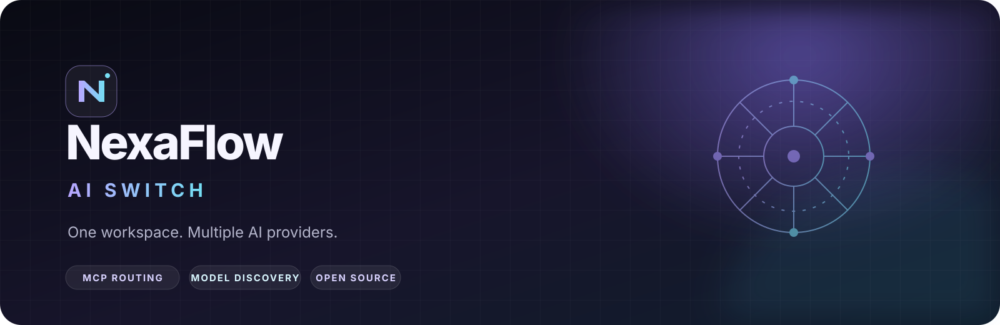

<!--
  NexaFlow AI Switch
  Keep this README honest: adapters do not guarantee provider access or free quota.
-->
<p align="center">
  
</p>

<p align="center">
  <a href="README-RU.md">Русская версия</a> ·
  <a href="INSTALLATION.md">Installation</a> ·
  <a href="INSTALLATION-RU.md">Установка на русском</a> ·
  <a href="CHANGELOG.md">Changelog</a>
</p>

<p align="center">
  <a href="https://github.com/malikovlev96-hash/NexaFlow-AI-Switch/releases/latest"></a>
  <a href="https://github.com/malikovlev96-hash/NexaFlow-AI-Switch/actions/workflows/ci.yml"></a>
  <a href="LICENSE"></a>
  <a href="https://nodejs.org/"></a>
</p>

<h1 align="center">One workspace. Multiple AI providers. Smarter fallback.</h1>

<p align="center">
  NexaFlow AI Switch connects Claude Desktop to a configurable set of AI provider APIs through MCP, with a separate OpenRouter-powered web companion for model discovery and chat.
</p>

<p align="center">
  <a href="https://github.com/malikovlev96-hash/NexaFlow-AI-Switch/releases/latest"><strong>⬇ Download latest release</strong></a>
  &nbsp;·&nbsp;
  <a href="INSTALLATION.md"><strong>Quick installation</strong></a>
  &nbsp;·&nbsp;
  <a href="https://github.com/malikovlev96-hash/NexaFlow-AI-Switch/issues/new/choose"><strong>Get help / report a bug</strong></a>
</p>

---

## What is NexaFlow?

NexaFlow is an open-source project with **two separate components**. They have different jobs and do not share keys, settings, chat history, or a backend.

| Component | What it does | Where it runs |
|---|---|---|
| **MCP extension** | Routes requests explicitly sent to NexaFlow tools, supports configured provider adapters, diagnostics and transient-error fallback | Claude Desktop |
| **Web companion (PWA)** | Browses the live OpenRouter catalogue, shows listed token prices, validates an OpenRouter key and provides streaming chat | Browser / installable PWA |

> **Important:** NexaFlow does not intercept Claude Desktop's built-in model selector, bypass subscription limits, or silently replace Claude's own model. It only handles requests that Claude explicitly sends to its MCP tools.

## Highlights

- **Multi-provider routing:** 18 provider adapters are included in the MCP server.
- **Safer fallback:** transient network, timeout, rate-limit and server errors can trigger a fallback; invalid credentials and invalid requests do not.
- **Provider diagnostics:** test a single configured provider or run bounded checks for configured providers.
- **Live model discovery:** the companion reads OpenRouter's public model catalogue and listed input/output prices.
- **Streaming chat:** send prompts through OpenRouter with a system prompt, temperature and output-token limit.
- **Useful workflow:** model search, favorites and local searchable chat history in the PWA.
- **Windows launcher:** start/stop the local companion and diagnose the local server from a simple menu.
- **Reproducible build:** GitHub Actions validates the source, runs tests and builds/verifies the MCPB package.

## Download

Go to **[GitHub Releases](https://github.com/malikovlev96-hash/NexaFlow-AI-Switch/releases/latest)** and download the assets attached to the latest release:

| File | Use it for |
|---|---|
| `NexaFlow-AI-Switch-1.7.0.mcpb` | Install the Claude Desktop MCP extension |
| `NexaFlow-AI-Switch-1.7.0-source.zip` | Windows launcher, PWA files, source code and documentation |

If the Releases page says that no release is published yet, use **Code → Download ZIP** for the source snapshot. The versioned release files appear after a maintainer publishes a version tag and the release workflow finishes.

## Quick start

### Windows — easiest route

1. Download and extract the source ZIP into a normal folder (not inside the ZIP preview).
2. Install **Python 3** if it is not already installed: [python.org/downloads](https://www.python.org/downloads/).
3. Double-click `START-NEXAFLOW.cmd`.
4. Choose **1** to start the local web companion. It opens in your browser at `http://127.0.0.1:8765/`.
5. Choose **2** from the same menu to stop the local server.

The local server binds to `127.0.0.1` only; it is not exposed to your local network.

### Claude Desktop — MCP extension

1. Download the `.mcpb` file from Releases.
2. Open the `.mcpb` file with Claude Desktop and confirm installation.
3. Open Claude Desktop's extension settings and add the API key for the provider you want to use.
4. Start with one provider and run `autoswitch_test_provider` before using routing.

If you downloaded the source ZIP instead, run `BUILD-MCPB.cmd` (Python 3 required) to build and verify the package, then open the generated file in `dist/`.

### Android / iPhone

The mobile companion is a **PWA**, not a signed APK or App Store app. Host the project root on HTTPS while preserving the `mobile/` and `assets/` folders, then open `/mobile/` on your phone and use the browser's **Install app** / **Add to Home Screen** action.

Full illustrated steps: [Mobile installation guide](mobile/INSTALL-MOBILE.txt).

## Provider integrations

The MCP server includes adapters for:

**xAI · Groq · Google Gemini · OpenRouter · Mistral · Cloudflare Workers AI · NVIDIA NIM · Cohere · SambaNova · Z.ai · OpenAI · DeepSeek · Cerebras · Together AI · Fireworks AI · Hugging Face · GitHub Models · Perplexity**

An adapter means that integration code is present — it does not guarantee that a provider, model, free tier or quota is available for every account or region. You supply and pay for your own API access where required. Check current model IDs, pricing and regional availability with each provider.

The PWA currently connects to **OpenRouter only**. Its model catalogue is not a universal catalogue for all MCP providers.

## Security & privacy

- Never commit API keys, tokens, passwords or private configuration.
- MCPB marks provider key fields as sensitive configuration.
- The PWA stores its OpenRouter key in browser `sessionStorage` for the current session and sends requests directly to OpenRouter over HTTPS.
- PWA chat history and favorites stay in that browser's local storage.
- Desktop MCP and the PWA do not sync credentials or history.
- Review [SECURITY.md](SECURITY.md) before deploying or sharing diagnostic logs.

## Build from source

Requirements: Node.js 18+ and Python 3.

```bash
npm test
npm run check
python tools/build_mcpb.py
python tools/verify_mcpb.py dist/NexaFlow-AI-Switch-1.7.0.mcpb
```

## Documentation

- [Windows / Claude Desktop installation](INSTALLATION.md)
- [Установка на русском](INSTALLATION-RU.md)
- [Russian project overview](README-RU.md)
- [Provider setup and official key links](docs/PROVIDERS-RU.md)
- [Changelog](CHANGELOG.md)
- [Security policy](SECURITY.md)
- [Contributing](CONTRIBUTING.md)
- [Audit report (Russian)](AUDIT-REPORT-RU.md)

## Current limitations

NexaFlow is actively developed, but it is not a magic replacement for every AI app. The MCP extension cannot control Claude Desktop's internal model choice or subscription limits. The PWA currently supports OpenRouter only. There is no cross-device sync, native signed APK/IPA, universal provider catalogue, persistent usage budget, push notification system or automatic updater in this release. See the full [Russian README](README-RU.md) for details.

## Contributing

Issues, bug reports, documentation improvements and tested provider adapters are welcome. Please use the issue templates and never attach real credentials. See [CONTRIBUTING.md](CONTRIBUTING.md).

---

<p align="center">
  <strong>NexaFlow AI Switch</strong><br>
  <sub>Built for clarity, control and a better multi-provider AI workflow.</sub>
</p>
